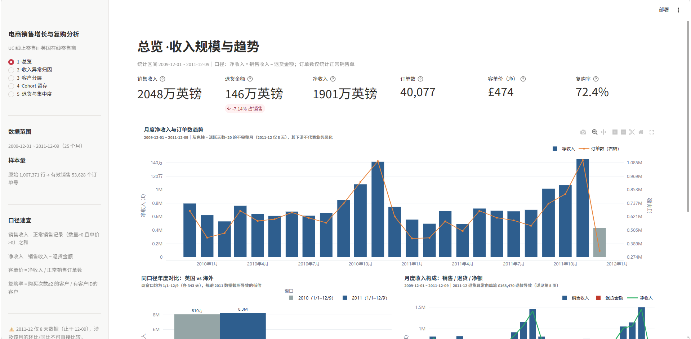
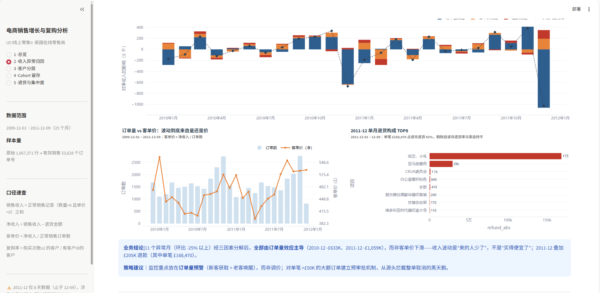
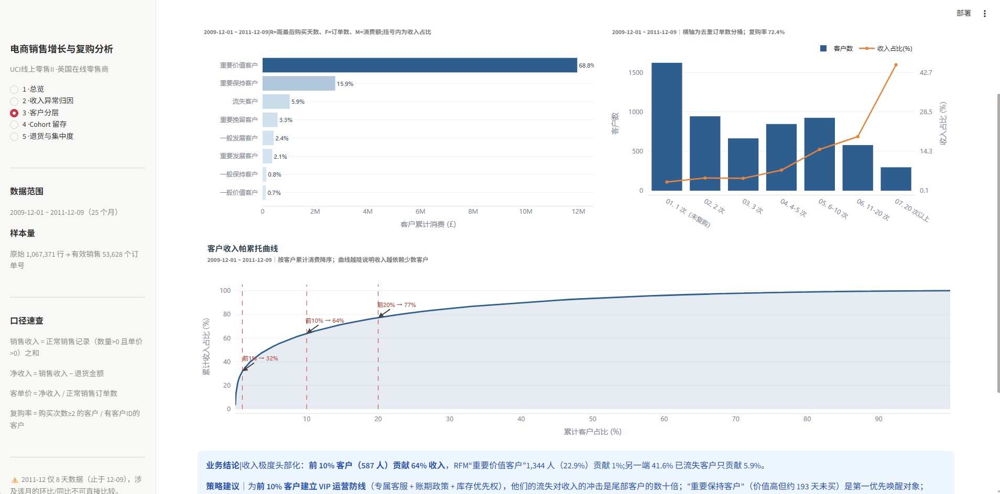
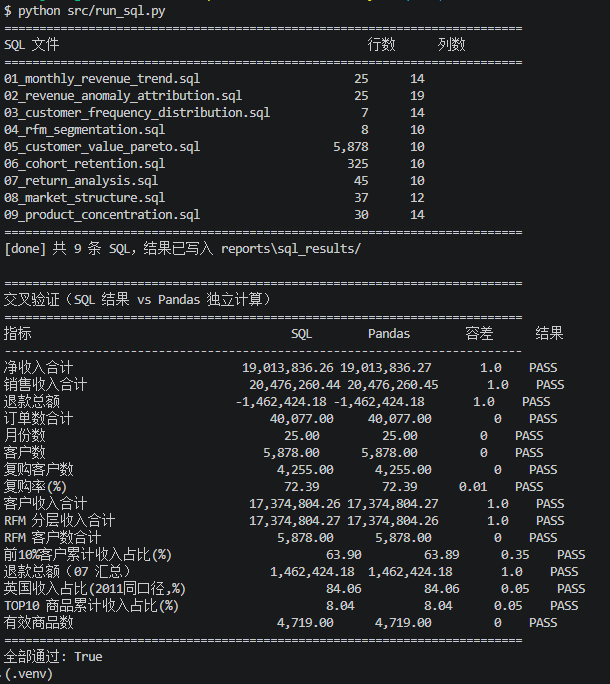

# 电商销售增长与客户复购分析平台

基于 **UCI Online Retail II**（英国在线零售商 25 个月、106.7 万行真实交易流水）的端到端数据分析项目：
清洗 → 建库 → 窗口函数专题 SQL → 业务报告 → Streamlit 可视化看板。

**所有结论由真实数据计算得出（无任何模拟数据），并通过三重质量校验。**

---

## 核心结论（数字均可复现）

| 维度 | 结论 |
|---|---|
| 收入规模 | 净收入 **£19.01M**（销售 £20.48M − 退货 £1.46M，退货率 7.14%），订单 40,077，客单价 £474.43 |
| 客户价值 | 复购率 **72.39%**；**前 10% 客户贡献 63.9% 收入**，前 1%（58 人）贡献 31.8% |
| RFM 分层 | 重要价值客户 1,344 人（22.9%）贡献 **68.8%** 收入，人均 £8,894 |
| Cohort 留存 | M+1 **20.3%** → M+12 **9.5%**；首月是留存分水岭 |
| 退货归因 | 单笔 £168,470 整单取消占全期退款 **11.5%**；主要"退货"实为平台费冲销，非质量问题 |
| 市场结构 | 英国占 **85.0%**；海外 France +42.3% / Germany +11.1% / EIRE **−24.3%** |
| 商品结构 | 4,719 个 SKU 的长尾市场，HHI 仅 **17.4**，无单品依赖风险 |

完整推导见 [reports/business_report.md](reports/business_report.md)，
速览版见 [reports/key_findings.md](reports/key_findings.md)，
简历可直接引用的表述见 [reports/resume_bullets.md](reports/resume_bullets.md)。

## 📊 看板展示

### 1. 总览与核心指标


### 2. 业务洞察与策略建议


### 3. 高级分析模型（Cohort 留存）


### 4. 数据口径与严谨性验证（交叉对账/自动化测试）


---

## 数据背景与方法论
（这里接你原本的“本项目采用 2009-2011 年的经典零售数据集...”）

## 数据背景与方法论

本项目采用 2009-2011 年的经典零售数据集，核心价值不在于呈现历史报表，而是为了验证一套**"从海量脏数据走向业务决策"的标准化分析框架**（包含行数守恒断言、16 项交叉验证对账、Cohort 归因等）。该管线具备高复用性，替换为任意现代业务底表，即可快速输出同等深度的商业诊断报告。

具体而言，这套框架沉淀了三类可迁移的方法论资产：

1. **口径资产**——销售收入 / 净收入 / 客单价 / 复购率等 8 项指标的定义与互斥分段清洗规则（见下文指标口径表），可直接套用到任何交易型底表；
2. **验证资产**——「分段加总守恒 → SQL/Pandas 双路径对账 → pytest 口径不变式」的三层质量防线，保证数字从产出到汇报全程可审计；
3. **归因资产**——三因素收入分解（订单量/客单价/退款）、Cohort 左右截断识别、单笔黑天鹅剔除等处理范式，规避"把数据缺陷误读为业务变化"的常见分析事故。

---

## 项目结构

```
ecommerce-retail-analysis/
├── data/
│   ├── raw/                  # 原始数据（不入库，见 data/README.md）
│   └── processed/            # 清洗产物 parquet / SQLite（不入库，可重建）
├── src/
│   ├── clean_data.py         # 清洗管线：7 段互斥分段 + 行数守恒断言
│   ├── build_db.py           # SQLite 建库 + Pandas 独立复算核心指标
│   └── run_sql.py            # 批量执行 SQL + SQL/Pandas 交叉验证
├── sql/                      # 9 条专题 SQL（CTE + LAG/RANK/NTILE/ROW_NUMBER/SUM OVER）
├── dashboard/app.py          # Streamlit 5 页看板（Plotly）
├── reports/
│   ├── business_report.md    # 业务报告：5 个问题 × 发现 × 建议
│   ├── key_findings.md       # 核心发现速览
│   ├── resume_bullets.md     # 简历描述（真实数字）+ 面试追问弹药库
│   └── sql_results/          # SQL 结果 CSV + 交叉验证报告 _verification.json
├── tests/test_metrics.py     # 9 个指标口径不变式测试
├── requirements.txt
└── README.md
```

---

## 快速开始

```bash
# 1. 环境（Python 3.12+，实测 3.13.7）
pip install -r requirements.txt

# 2. 获取数据（UCI 官方源，约 44 MB）
curl -L -o data/raw/online_retail_ii.zip "https://archive.ics.uci.edu/static/public/502/online+retail+ii.zip"
unzip data/raw/online_retail_ii.zip -d data/raw/
# 数据获取与校验和说明见 data/README.md

# 3. 一键跑通管线（按顺序）
python src/clean_data.py      # 清洗 → data/processed/*.parquet + quality_report.json
python src/build_db.py        # 建库 → data/processed/retail.db + core_metrics.json
python src/run_sql.py         # 9 条 SQL → reports/sql_results/*.csv + 交叉验证
python -m pytest tests/       # 9 个口径测试

# 4. 打开看板
streamlit run dashboard/app.py
```

---

## 指标口径（所有分析的基础约定）

| 指标 | 口径 |
|---|---|
| 销售收入 | Quantity > 0 且 UnitPrice > 0 的记录 Revenue 合计 |
| 净收入 | 销售收入 − 退货/取消金额 |
| 订单数 | 正常销售的唯一 InvoiceNo 数 |
| 客单价 | 净收入 / 订单数 |
| 客户数 | 唯一 Customer ID；客户级分析排除缺失 ID 的匿名交易（21.4% 行数） |
| 复购率 | 购买次数 ≥ 2 的客户 / 有 Customer ID 的客户 |
| 退货率 | \|退货金额\| / 销售收入 |
| RFM | R=距最后购买天数、F=去重订单数、M=累计消费；各维 NTILE(5) 打分（≥4 为高） |

**清洗账目（行数守恒，脚本内 assert 强制）**：

```
1,067,371  原始合并行数
−  34,335  完全重复行（双 sheet 时间重叠）
−       1  取消单但数量为正（手工调整异常）
−  19,103  取消/退货单（C 开头，单独成表）
−   3,393  负数量非取消单（库存调整/坏账核销）
−   2,626  单价 ≤ 0（赠品/样品/调价）
− 228,488  匿名交易（客户 ID 缺失，仍计入收入）
= 779,425  正常销售明细
```

---

## 质量保障：三道防线

1. **清洗层**：7 段互斥分段，脚本内断言「分段加总 == 原始行数」「sales 恒正、returns 恒负」，
   任何口径破坏直接抛异常而不是出错误报告。
2. **分析层**：SQL 与 Pandas 两条独立路径各算一遍核心指标，**16 项交叉验证全部一致**
   （结果见 `reports/sql_results/_verification.json`）——单路径自证没有意义。
3. **测试层**：9 个 pytest 口径不变式（复购率定义、退货表零重叠、判重 8 列口径、截断月识别等），
   `python -m pytest tests/` 全部通过。

---

## 数据陷阱的显式处理（本项目刻意强调的部分）

| 陷阱 | 影响 | 处理 |
|---|---|---|
| **2011-12 仅 8 天数据**（止于 12-09） | 直接同比会得出"-70% 崩盘"的错误结论 | 同比改用"截至 12-09"同窗口口径；趋势图置灰该月 |
| 双 sheet 时间重叠（2010-12-01~12-09） | 不去重则收入虚增 | 按业务 8 列判重，删除 34,335 行 |
| C 开头但数量为正的异常单 | 混入退货表会污染退货率 | 单列分段排除 |
| Cohort 左截断（2009-12） | 存量客户被误判为新客（955 人） | 报告与看板显式标注，不与新客 cohort 直接比较 |
| 同一发票同商品被录入两种描述 | 7 列判重会误删合法行 | 判重严格按 8 列口径，测试锁定 |
| Invoice 列混合类型（int + 'Cxxx'） | `.str.startswith('C')` 静默失效 | 读取层强制统一为 string |

---

## 技术栈

- **数据处理**：Python 3.13 / pandas 3.0 / pyarrow（parquet 中间层，避免重复解析 44 MB xlsx）
- **分析**：SQLite（窗口函数：LAG、RANK、ROW_NUMBER、NTILE、SUM OVER）
- **可视化**：Streamlit 1.58 + Plotly 7，5 页侧边栏看板，每页 ≤ 3 图 + 1 段结论
- **质量**：pytest 9 个口径测试 + SQL/Pandas 16 项交叉验证

## 已知局限

- 2011-12 数据不完整（8 天），全期同比需使用同窗口口径；
- 21.4% 交易缺失客户 ID（匿名交易），计入收入但无法做客户级分析；
- RFM 的 NTILE 打分与 pandas.qcut 分位切分在个体级存在微小实现差异（分层占比结论不受影响）；
- 未建模客户获取成本/利润率（数据集不含），所有"价值"均以收入口径计。
